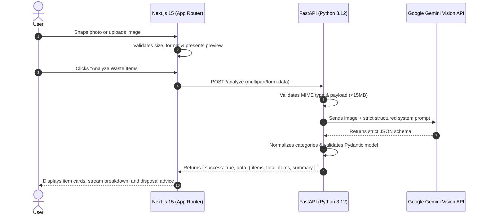

# SmartSort AI ♻️

> **Snap your waste. Know where it goes.**  
> An intelligent, mobile-first multi-object waste detection and sorting assistant built as a production-quality Final Year Project (FYP) demo. Powered by **Next.js**, **FastAPI**, and **Google Gemini Vision**.

---

## 🌟 Overview

Waste sorting is one of the most critical steps in municipal recycling, yet everyday consumers often struggle with multi-material packaging, contaminated bins, and unclear local disposal rules. 

**SmartSort AI** solves this by enabling users to point their mobile camera or upload an image containing multiple mixed waste objects (such as plastic water bottles, soda cans, coffee cups, or organic food scraps). Instead of simply giving a single overall label, SmartSort AI:
1. **Detects multiple distinct items** in a single image.
2. **Counts quantities** of identical items (e.g., *Plastic Bottle × 3, Aluminum Can × 2*).
3. **Classifies into 10 standard waste streams**.
4. **Delivers actionable, step-by-step disposal advice** (rinsing, flattening, separating lids, hazardous battery drop-offs).
5. **Provides conservative confidence metrics** and transparent AI limitations.

---

## 🚀 Key Features

- **Live Browser Camera Stream**: Uses `MediaDevices.getUserMedia` with mobile rear-camera (`environment`) preference and camera flip support.
- **File Upload & Drag-and-Drop**: Support for JPG, PNG, and WEBP formats with direct capture fallback.
- **Multi-Object Waste Decomposition**: Distinguishes multiple separate objects rather than a naive single-class label.
- **Item Counting**: Automatically aggregates identical items with quantity counters (`× 3`).
- **10 Core Streams**:
  - `plastic` (Bottles, tubs, rigid containers)
  - `paper` (Clean office paper, newsprint, pamphlets)
  - `cardboard` (Boxes, cartons flattened)
  - `glass` (Beverage bottles, condiment jars)
  - `metal` (Aluminum cans, food tins, scrap)
  - `biological` (Food scraps, peels, organic waste)
  - `battery` (Alkaline, lithium-ion, hazardous drop-off)
  - `shoes` (Footwear, sneakers for donation/special drop-off)
  - `clothes` (Textiles, fabric, clothing donations)
  - `trash` (Non-recyclable wrappers, contaminated items, landfill)
- **Isolated Gemini Service**: Modular Python backend architecture allowing easy model and provider upgrades.
- **Student FYP Aesthetic**: Sleek dark/light UI, eco-themed badges, real-time backend health check, and animated scanning line visualizer.

---

## 🏗️ Architecture & Flow



---

## 🛠️ Tech Stack

| Layer | Technology | Purpose |
|---|---|---|
| **Frontend Framework** | Next.js 15 (App Router) | High-performance React application |
| **Language** | TypeScript | Strong typing for API payloads & UI states |
| **Styling** | Tailwind CSS | Modern, responsive mobile-first design |
| **Icons** | Lucide React | Clean, intuitive status and stream icons |
| **Backend Framework**| FastAPI (Python 3.12) | Asynchronous, lightweight REST API |
| **Server** | Uvicorn | ASGI production-grade web server |
| **Validation** | Pydantic v2 | Strict schema parsing and data normalization |
| **AI Vision Engine** | Google Gemini Vision API | Multi-object scene understanding & stream reasoning |
| **Environment** | python-dotenv | Secure server-side credential isolation |

---

## ⚠️ Important Limitations & AI Disclosure

> [!IMPORTANT]
> - **Probabilistic Vision Estimation**: Detection is performed via Google Gemini Vision reasoning over visual features. It is an AI estimate and may occasionally merge, miss, or misclassify small, occluded, or heavily shadowed objects.
> - **No Physical Segmentation**: This MVP does not claim pixel-level instance segmentation masks (such as Mask R-CNN or YOLO polygon masks). It produces semantic object detections, counts, and category classifications.
> - **Local Municipal Rules**: Recycling regulations differ by municipality. The app provides best-practice general guidance (e.g., rinse containers, remove bottle caps where required), but users should check local regulations.

---

## 📁 Project Structure

```text
smartsort-ai/
├── frontend/
│   ├── app/
│   │   ├── globals.css         # Tailwind directives & custom animations
│   │   ├── layout.tsx          # Root layout & SEO meta tags
│   │   └── page.tsx            # Main application flow (camera/upload/results)
│   ├── components/
│   │   ├── CameraCapture.tsx   # getUserMedia camera stream & canvas snap
│   │   ├── Footer.tsx          # Branding & footer links
│   │   ├── Header.tsx          # App bar with live backend health monitor
│   │   ├── ImageUploader.tsx   # Drag-and-drop & file picker
│   │   ├── LoadingOverlay.tsx  # Animated scanner line & progress step indicators
│   │   └── ResultsDisplay.tsx  # Detailed cards, stream breakdown & instructions
│   ├── lib/
│   │   ├── api.ts              # Fetch client for /analyze and /health
│   │   └── types.ts            # Waste categories & response schemas
│   ├── next.config.ts
│   ├── package.json
│   ├── postcss.config.mjs
│   ├── tailwind.config.ts
│   └── tsconfig.json
│
├── backend/
│   ├── services/
│   │   ├── __init__.py
│   │   └── gemini_service.py   # Isolated Gemini Vision API service
│   ├── .env.example            # Environment template
│   ├── .env                    # Local secrets (never committed to git)
│   ├── main.py                 # FastAPI application & CORS routing
│   └── requirements.txt        # Python backend dependencies
│
└── README.md
```

---

## ⚙️ Environment Variables

### Backend (`backend/.env`)

Create `backend/.env` (or copy from `backend/.env.example`):

```env
# Your Google Gemini API Key from Google AI Studio:
GEMINI_API_KEY=your_gemini_api_key_here

# (Optional) Preferred Gemini Model - defaults to gemini-3.6-flash
GEMINI_MODEL=gemini-3.6-flash

# Backend server port
PORT=8000

# Allowed CORS origins
ALLOWED_ORIGINS=http://localhost:3000,http://127.0.0.1:3000
```

> [!CAUTION]
> Never expose your `GEMINI_API_KEY` to the frontend. All Gemini requests are securely made through the FastAPI backend.

### Frontend (`frontend/.env.local`, optional)

```env
NEXT_PUBLIC_API_URL=http://localhost:8000
```

*(Defaults to `http://localhost:8000` if omitted)*.

---

## 🚀 Getting Started

### Prerequisites
- **Node.js**: v18+ (v20+ recommended)
- **Python**: 3.10+ (tested on Python 3.12)
- **Gemini API Key**: Free tier or paid key from [Google AI Studio](https://aistudio.google.com/)

---

### Step 1: Run the Backend

1. Navigate to the backend directory:
   ```bash
   cd backend
   ```

2. Create and activate a Python virtual environment:
   ```powershell
   # Windows PowerShell:
   python -m venv venv
   .\venv\Scripts\activate
   ```

3. Install requirements:
   ```powershell
   pip install -r requirements.txt
   ```

4. Configure your Gemini API Key in `backend/.env`:
   ```env
   GEMINI_API_KEY=AIzaSy...
   ```

5. Start the FastAPI server:
   ```powershell
   python main.py
   # OR:
   uvicorn main:app --reload --port 8000
   ```

6. Verify the server is running:
   Open [http://localhost:8000/health](http://localhost:8000/health) — should return `{"status": "ok"}`.
   Interactive Swagger docs available at [http://localhost:8000/docs](http://localhost:8000/docs).

---

### Step 2: Run the Frontend

1. Open a new terminal and navigate to the frontend:
   ```bash
   cd frontend
   ```

2. Install dependencies:
   ```bash
   npm install
   ```

3. Start the Next.js development server:
   ```bash
   npm run dev
   ```

4. Open [http://localhost:3000](http://localhost:3000) in your browser (or open via your mobile device on the same local Wi-Fi network).

---

## 📡 API Endpoints

### 1. `GET /health`
Returns backend health status.
```json
{
  "status": "ok"
}
```

### 2. `POST /analyze`
Accepts `multipart/form-data` with an image file under the field `file`.

**Sample Request**:
```bash
curl -X POST "http://localhost:8000/analyze" \
  -F "file=@sample_waste.jpg;type=image/jpeg"
```

**Sample Response**:
```json
{
  "success": true,
  "data": {
    "items": [
      {
        "name": "plastic water bottle",
        "category": "plastic",
        "quantity": 3,
        "confidence": 0.94,
        "recyclable": true,
        "disposal_method": "Empty remaining liquid, rinse clean, flatten bottle, and replace cap before placing in blue recycling bin."
      },
      {
        "name": "aluminum soda can",
        "category": "metal",
        "quantity": 1,
        "confidence": 0.96,
        "recyclable": true,
        "disposal_method": "Rinse clean and place in metal recycling bin."
      }
    ],
    "total_items": 4,
    "summary": "Detected 3 plastic water bottles and 1 aluminum soda can. All items are recyclable after rinsing."
  },
  "message": null
}
```
